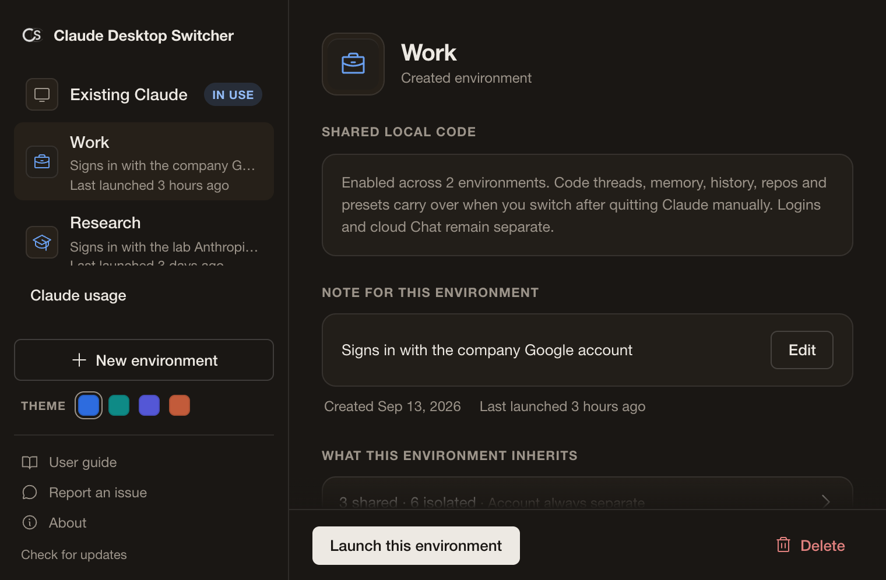

# Claude Desktop Switcher


## This fork: shared local Code by default

To build this fork on macOS (Xcode command-line tools and the pinned Rust toolchain required):

```sh
git clone https://github.com/seichris/claude-desktop-switcher.git
cd claude-desktop-switcher
sh scripts/build-local-app.sh
open target/release/bundle/macos/Claude-Desktop-Switcher.app
```

Create each account with the default **Share local Code** mode. It shares Code transcripts,
project memory and input history; rules, permissions, plugins, skills and sign-ins stay
separate. Existing environments keep their current settings. Sign in normally in Claude
Desktop and open Code once in Existing Claude and the new environment. Finish all tasks
and input waits, quit Claude manually, then select the new environment in Switcher and
choose **Set up shared Code → Back up and enable sharing**. The source is Existing Claude;
when adding another account, the sharing group's latest changes are carried forward.

After that one-time setup, launch accounts through Switcher to carry **all local Code
threads, archived/deleted records, saved repos/worktrees and Code presets** forward.
If Claude is running, Switcher waits for you to quit it manually. For manual switches, it never quits or
force-quits Claude. Existing worktree files stay in place. Cloud Chat conversations,
cloud Projects, Desktop logins and usage quotas remain account-specific. No CLI sign-in,
credential extraction, account-specific config template or extra network client is needed.
Use **Separate everything** when you need independent histories instead.

The build outputs include the matching `target/release/csw` CLI. Upstream release binaries
do not contain these fork changes. See [setup and recovery](docs/USER_GUIDE_EN.md#complete-local-code-sharing-in-this-fork)
and [local builds](docs/LOCAL_BUILD.md).

---

<p align="center">
  
</p>

<p align="center">
  <a href="https://matsumotory.github.io/claude-desktop-switcher/"><strong>Website</strong></a>
  &nbsp;·&nbsp;
  <a href="https://github.com/matsumotory/claude-desktop-switcher/releases/latest">Download (.dmg)</a>
  &nbsp;·&nbsp;
  <a href="docs/USER_GUIDE_EN.md">User Guide</a>
  &nbsp;·&nbsp;
  <a href="docs/PRIVACY_EN.md">Privacy and Transparency</a>
</p>

*Read this in other languages: [日本語 (Japanese)](#日本語-japanese)*

Claude Desktop Switcher is a macOS menu bar utility for separating the whole Claude Desktop App suite (chat, Projects, Claude Cowork, Artifacts, Claude Design, and Claude Code integration) by account and use case on a single Mac. Switching CLI profiles alone is already well served by existing tools like direnv and claude-swap. CSW's focus is keeping your whole desktop workspace separate, with the CLI linked when you want it. The Desktop App has no native multi-account switching, so CSW lets you switch environments without signing out each time. You can customize the isolation level per use case, and it also links the Claude Code (CLI) environment to your GUI selection. It works for non-engineers who never touch a terminal, as well as developers who want CLI integration.

<p align="center">
  
</p>

## Return after Claude updates

Enable `csw update-return on` to return to the environment that was last observed
running alone after Claude's updater opens Existing Claude. Keep Switcher running.
The feature verifies that the installed app changed and the restart is recent,
requests a normal quit of that exact new instance, then hands off history and
reopens the saved environment. Real history conflicts still stop the handoff.
Use `csw update-return off` to disable it or `csw update-return status` to check.
This fork's local.13 or later app and CLI are required.

## Use Cases & Solutions

How should you partition your environments on a single PC? You can flexibly adjust the isolation level to suit your workflow.

- **01. Separate the whole suite per project/client**
  When running multiple clients or projects in parallel, you want to avoid mixing chat history, Projects memory, Cowork working folders, and Artifacts. Selecting "Separate everything" allocates a separate data directory for each environment and keeps each login separate, structurally preventing information from leaking across the desktop suite.

- **02. Separate work and personal on one Mac (no terminal needed)**
  Keep your business and personal accounts apart without touching the terminal. Just pick an environment and the Claude Desktop App switches without signing in again. It is complete in the GUI.

- **03. Separate by use case while sharing global rules**
  When you want separate accounts but want to reuse global rules and settings. Pick "Separate conversations and memory too" to keep specific files (such as `CLAUDE.md`) shared across environments while keeping history and logins separate.

- **04. Link the CLI to your GUI separation (for developers)**
  Link the environment you chose in the GUI to the CLI's `CLAUDE_CONFIG_DIR`. Run `eval $(csw env <env-name>)` (replace `<env-name>` with your environment's name) in a separate terminal to use the CLI in the same isolated environment. This adds GUI consistency on top of what existing CLI-only switchers already solve.

## Features

- **Integrated Management for GUI & CLI**: Centrally manages the environments behind the Claude Desktop App and Claude Code (CLI). Switch GUI environments by selecting one; sync the CLI to the same isolated environment by running a command in a separate terminal.
- **Customizable Isolation**: You can choose which settings to share and which data to separate based on your use case.
- **Launch after manual quit in this fork**: Select the next environment first. If Claude Desktop is running, the local app reserves the launch and waits for you to finish work and quit every Desktop instance normally. The settings window shows the target and cancellation while waiting; Manual switches never request quit or detect task completion. The reservation clears when CSW quits. No Accessibility permission or extra CLI sign-in is needed. Requires [the local app](docs/LOCAL_BUILD.md); see [the manual-quit guide](docs/USER_GUIDE_EN.md#launch-after-you-quit-claude).
- **Saved Claude usage in this fork**: Local builds show each discovered environment's saved usage percentages, available resets, and last-checked time. Stale and missing data are explicit. The reader uses only existing Desktop usage files and matching local cache responses, with no network requests or credential access. This addition is not part of the upstream downloads linked above; see [the local-cache guide](docs/USER_GUIDE_EN.md#checking-saved-claude-usage).
- **Complete local Code sharing in this fork**: Explicitly synchronize the full local Desktop Code sidebar, worktree bookkeeping and saved presets between environments, keeping Desktop sign-ins separate. Synchronization runs before a participating launch with Claude stopped, after backups, without a CLI login. Disable it with `csw unshare-code`; current data and logins remain. This addition requires [the local app and CLI](docs/LOCAL_BUILD.md), rather than the upstream downloads. See the [sharing guide](docs/USER_GUIDE_EN.md#complete-local-code-sharing-in-this-fork).
- **Zero-Impact Isolation**: It does not arbitrarily overwrite your Mac's global system settings. Settings are applied locally only to the apps or specific terminal tabs launched by this tool. Existing Claude is preserved by default. Explicitly enabling complete local Code sharing additionally replaces its Code stores, while leaving sign-in storage separate.

## Usage

### GUI Workflow

Environment management and the one-time complete local Code sharing setup are available in the settings window. The CLI setup command remains available for explicit source selection and recovery.

1. **Install & Launch**: Place `Claude-Desktop-Switcher.app` in your Applications folder and launch it. The settings window opens.
2. **Create Environments**: In the settings window, create independent environments such as "Work" or "Research" with a single click.
3. **Launch in Isolated Environment**: Select an environment and press "Launch this environment" (`この環境を起動`); that environment's Claude Desktop App launches against its own isolated directory. In this fork's local app, if another Claude is running, the launch waits until you finish work and quit every Claude Desktop instance normally with Cmd+Q. Closing a window may leave the app running. Upstream downloads require quitting Claude before pressing the launch button. An environment set to "separate everything" shares nothing, so you can instead open it alongside a running Claude with "Launch alongside" (`重複して起動`), without quitting.

### Terminal (Claude Code) Integration

There are two kinds of terminal, and they need different steps.

**1. The terminal inside the Claude Desktop app you launched from CSW (built-in)**
When you switch to an environment and launch it from CSW, any terminal you open inside that app is already in that environment. No extra command is needed; just type `claude` to start working.

**2. A separate terminal you open yourself (external, e.g. iTerm2)**
A terminal you open on your own stays in your usual environment. To use a specific environment, run the sync command below (it points the CLI's `CLAUDE_CONFIG_DIR` at that environment's directory, applies to that tab only, and never affects your usual environment):

```bash
eval $(csw env <env-name>)
```

**Get the `csw` CLI.** The `.dmg` ships the menu-bar app only. Download the signed, notarized `csw` binary from the [latest release](https://github.com/matsumotory/claude-desktop-switcher/releases/latest), make it executable, and move it onto your `PATH` (`chmod +x csw && mv csw /usr/local/bin/`). With a Rust toolchain you can instead run `cargo install --path crates/cli`. Updating the app does not update `csw`; run `csw --version` to see which version you have. The GUI works without this step, except for repairing links with `csw doctor --fix`.

## Build from Source (.dmg)

You can easily build the macOS installer (`.dmg`) using Tauri.

```bash
# Execute build (npm install is required beforehand)
npm run tauri build

# Or, if you use Cargo
cargo tauri build
```
Once the build is complete, the disk image (`Claude-Desktop-Switcher_<version>_<arch>.dmg`) is generated in `target/release/bundle/dmg/`.

## Project Structure (For Developers)

```
crates/
  core/      # Core library (Profile management, file watching, etc.)
  cli/       # CLI tool (csw command)
  desktop/   # Tauri v2 menu bar app and settings UI
```

## Why Rust and Tauri

CSW is built around a shared Rust library (`crates/core`) that handles environment isolation, path resolution, and data safety; the CLI (`csw`) and the menu-bar GUI are thin layers over that same core. Because the top priority is never destroying your existing Claude data, the core lives in Rust, where invariants are enforced at compile time.

The GUI uses Tauri v2, which renders through the operating system's WebView (WebKit on macOS) instead of bundling a browser engine. The result is a small download (the universal DMG is around 7 MB), and code signing plus notarization run through Tauri's standard distribution flow.

This also keeps the development and verification loop easy to automate: the core is checked continuously by the Rust compiler, clippy, and tests, and the UI can be rendered and inspected with a standard headless browser in CI.

For native macOS UI, Apple's Swift and SwiftUI are the first choice, and an excellent one for apps that need deep system integration or a richly crafted native experience. Because CSW's value centers on systems-level logic with a thin UI, we prioritized core correctness and an automatable verification loop. A different kind of app would call for a different choice.

## License

MIT

---

## 日本語 (Japanese)

*Read this in English: [English](#claude-desktop-switcher)*

<p align="center">
  
</p>

<p align="center">
  <a href="https://matsumotory.github.io/claude-desktop-switcher/"><strong>Webサイト</strong></a>
  &nbsp;·&nbsp;
  <a href="https://github.com/matsumotory/claude-desktop-switcher/releases/latest">ダウンロード (.dmg)</a>
  &nbsp;·&nbsp;
  <a href="docs/USER_GUIDE.md">ユーザーガイド</a>
  &nbsp;·&nbsp;
  <a href="docs/PRIVACY.md">プライバシーと透明性</a>
</p>

チャット・Projects・Claude Cowork・Artifacts・Claude Design・Claude Code連携を含むClaudeデスクトップアプリのスイート全体を、アカウント／用途ごとに安全に分けて1つのMacで使い分けるためのメニューバーアプリです。CLIのプロファイル切り替えは、direnvやclaude-swapなど既存ツールが既によく解決しています。CSWが担うのは、デスクトップの作業全体を分け、必要ならCLIも同じ環境に連動させることです。デスクトップアプリはネイティブの複数アカウント切替を備えていないため、再ログインなしで環境を切り替えられます。用途に合わせて分離度を細かくカスタマイズでき、GUI側の環境分離にClaude Code（CLI）も連動させられます。ターミナルを使わない方から、CLI連携まで一貫させたい開発者まで対応します。

<p align="center">
  
</p>

### 解決する課題と利用シーン

1つのPCの中で環境をどう分けるか。あなたのワークスタイルに合わせて柔軟に分離度を調整できます。

- **01. 案件・クライアントごとにスイート丸ごと分ける**
  複数のクライアント案件やプロジェクトを並行する際、チャット履歴・Projectsのメモリ・Coworkの作業フォルダ・Artifactsが混ざる懸念を避けたい場合に。「すべて分ける」を選ぶと、環境ごとに独立したデータディレクトリが割り当てられ、ログインも環境ごとに分かれるため、別案件の文脈へ漏れる事故を構造的に防ぎます。

- **02. 仕事用と個人用を1台で分ける（非エンジニア向け）**
  業務アカウントと個人アカウントを混ぜたくないが、ターミナル操作はしたくない場合に。環境を選ぶだけで、再ログインなしに別アカウントのデスクトップアプリへ切り替わります。GUIだけで完結します。

- **03. 用途ごとに分けつつ共通ルールは共有する**
  アカウントは用途別に分けたいが、共通の運用ルールや設定は使い回したい場合に。「会話とメモリも分ける」を選ぶと、特定の設定ファイル（CLAUDE.md等）は全環境で共有したまま、履歴やログインは分離され、設定の二重管理を防げます。

- **04. GUIの分離にCLIを連動させる（開発者向け）**
  GUIで分けた環境をClaude Code（CLI）側でも同じ環境で使いたい場合に。GUIで選んだ環境に`CLAUDE_CONFIG_DIR`を連動させ、別に開いたターミナルで`eval $(csw env <環境名>)`（`<環境名>`は対象の環境名に置き換え）を実行すれば、CLIもその隔離環境で動きます。CLI単体スイッチャーが既に解決している領域に、GUI分離との一貫性を足します。

### Claudeの更新後に元の環境へ戻す

このforkのローカル版local.13以降のアプリとCLIで`csw update-return on`を実行し、CSWを起動したままにしてください。単独で利用中だった環境の終了、アプリの入れ替え、新しい既存のClaudeの起動を確認した場合、対象に通常終了を要求し、履歴を引き継いで元の環境へ戻します。履歴が競合した場合は停止します。無効化は`csw update-return off`、設定の確認は`csw update-return status`です。

### アプリの特徴

- **GUIとCLIの統合環境管理**：ClaudeデスクトップアプリとClaude Code（CLI）の背後の環境を一元管理します。GUIの環境を選んで切り替えるほか、別に開いたターミナルでコマンドを実行すれば、CLIも同じ隔離環境へ同期できます。
- **分離度のカスタマイズ**：共有したい設定と分けたいデータを用途に合わせて選択可能です。
- **このフォークの手動終了後の起動**：先に次の環境を選びます。Claude Desktopが起動中なら、ローカルアプリが起動を予約し、作業を終えてすべてのDesktopを通常終了するまで待ちます。待機中は設定ウインドウに予約先とキャンセルを表示します。手動の起動予約ではCSWは終了要求や作業の完了判定を行いません。CSWを終了すると予約は消えます。Accessibilityの許可や追加のCLIログインは不要です。[ローカルアプリ](docs/LOCAL_BUILD.md)が必要です。[手動終了後の起動のガイド](docs/USER_GUIDE.md#claudeを終了してから予約した環境を開く)を参照してください。
- **このフォークで保存済みのClaudeの利用量を表示**：ローカルビルドでは、見つかった各環境の使用率、記録にあるリセット時刻、最終確認時刻を表示し、古い記録と未取得を明示します。既存のDesktopの利用量ファイルと対応するローカルキャッシュだけを読み、通信や認証情報の読み取りは行いません。この追加機能は、上で案内している上流の配布版には含まれません。[ローカル記録のガイド](docs/USER_GUIDE.md#保存済みのclaudeの利用量を確認する)を参照してください。
- **このフォークでローカルCode全体を共有**：DesktopのローカルCodeサイドバー、ワークツリーの管理情報、保存済みのCodeプリセットを、ログインを分離したまま明示的に同期できます。全Claudeの終了とバックアップ後、参加環境の起動前に同期し、CLIへのログインは追加しません。`csw unshare-code`で無効にしても、現在のデータとログインは維持します。上流の配布版ではなく、[ローカルのアプリとCLI](docs/LOCAL_BUILD.md)が必要です。[共有のガイド](docs/USER_GUIDE.md#このフォークでローカルcode全体を共有する)を参照してください。
- **局所的な環境の適用 (Zero-Impact Isolation)**：Mac本体のシステム設定を無差別に上書きすることはありません。設定は本ツールから起動したアプリや特定のターミナルタブに対してのみ局所的に適用されます。既定では既存のClaudeを維持します。ローカルCode全体の共有を明示的に有効にした場合はCodeストアも置き換え、サインイン情報は分離して保持します。

### 使用方法

#### GUIワークフロー

環境の管理とローカルCode全体の共有設定は、設定ウインドウで操作できます。共有元を明示する場合や復旧用にCLIコマンドも使えます。

1. **インストール＆起動**：`Claude-Desktop-Switcher.app`をアプリケーションフォルダに入れて起動。設定ウインドウが開きます。
2. **環境の作成**：設定ウインドウで、ワンクリックで「業務」「研究」など、独立した環境を作成。
3. **分離環境での起動**：環境を選んで「この環境を起動」を押すと、その環境専用の隔離ディレクトリでClaudeデスクトップアプリが起動します。このフォークのローカルアプリでは、別のClaudeが起動中なら、作業を終えてすべてのClaude DesktopをCmd+Qで通常終了するまで起動を待ちます。ウィンドウを閉じただけでは、アプリが動き続ける場合があります。上流の配布版では、起動ボタンを押す前にClaudeを終了してください。「すべて分ける」で作った環境は何も共有しないため、代わりに「重複して起動」で並べて開けます。

#### ターミナル（Claude Code）連携

ターミナルには2種類あり、必要な操作が違います。

**1. CSWから開いたClaudeデスクトップアプリの中のターミナル（内蔵）**
このアプリから環境を起動した場合、その中で開くターミナルは最初からその環境になっています。追加のコマンドは不要で、そのまま`claude`と入力して作業を始められます。

**2. 別に開くターミナル（外部・iTerm2等）**
ご自身で新しく開いたターミナルは、普段の環境のままです。対象の環境を使うときは、次の連携コマンドを実行します（CLIの`CLAUDE_CONFIG_DIR`を対象環境のディレクトリに向けます。そのタブだけに適用され、普段の環境には影響しません）。

```bash
eval $(csw env <環境名>)
```

**`csw`コマンドを入手します。** `.dmg`にはメニューバーアプリのみが含まれます。署名・公証済みの`csw`バイナリを[最新リリース](https://github.com/matsumotory/claude-desktop-switcher/releases/latest)からダウンロードし、実行権を付けて`PATH`の通った場所に置いてください（`chmod +x csw && mv csw /usr/local/bin/`）。Rustの開発環境があれば`cargo install --path crates/cli`でも導入できます。アプリを更新しても`csw`は更新されません。入れている版は`csw --version`で確かめられます。GUIだけで使う場合は、`csw doctor --fix`でのリンクの修復を除いて不要です。

### 配布用ビルド（DMGファイルの作成）

Tauriを利用して、Mac用のインストーラ（`.dmg`）を簡単にビルドできます。

```bash
# ビルドの実行（事前に npm install 等が必要です）
npm run tauri build

# または、Cargo を使う場合
cargo tauri build
```
ビルドが完了すると、`target/release/bundle/dmg/`に`.dmg`（`Claude-Desktop-Switcher_<version>_<arch>.dmg`）が生成されます。

### プロジェクト構成（開発者向け）

```
crates/
  core/      # コアライブラリ (プロファイル管理、ファイル監視など)
  cli/       # CLIツール (csw コマンド)
  desktop/   # Tauri v2 を用いたメニューバーアプリと設定画面
```

### なぜRustとTauriなのか

CSWの中核は、環境の隔離・パス解決・データ保護を担う共有のRustライブラリ（`crates/core`）です。CLI（`csw`）とメニューバーGUIは、どちらもこの同じコアの上に薄く乗っています。ユーザーの既存Claudeデータを壊さないことが最優先のため、不変条件をコンパイル時に固められるRustを中核に置いています。

GUIはTauri v2で、macOS標準のWebView（WebKit）を使い、ブラウザエンジンを同梱しません。そのため配布物は小さく（universalのDMGで約7MB）、署名と公証もTauriの標準的な配布フローでそのまま行えます。

この構成は、開発と検証のループを自動で回しやすい利点もあります。中核はRustのコンパイラ・clippy・テストで継続的に検証でき、画面は標準的なヘッドレスブラウザでCI上でもレンダリング確認できます。

macOSネイティブUIの第一候補はAppleのSwiftとSwiftUIで、深いシステム統合や作り込んだネイティブ体験が必要なアプリには優れた選択肢です。CSWは価値の中心がシステム寄りのロジックにありUIが薄いため、コアの正しさと自動で回る検証を優先しました。用途が変われば、最適な選択も変わります。

## ライセンス

MIT
