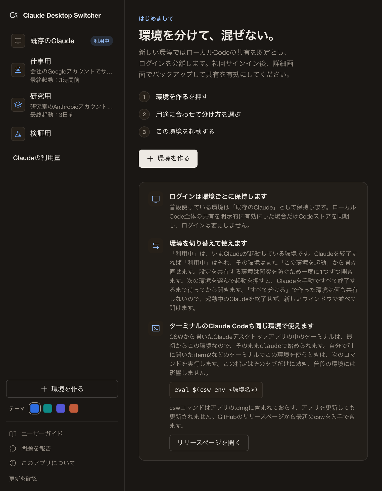
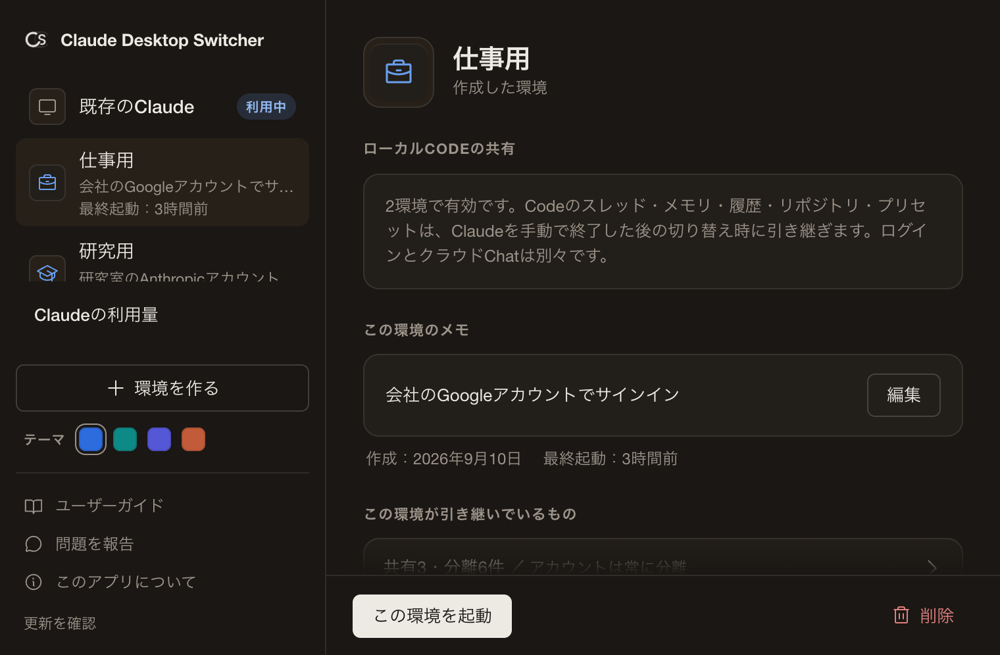
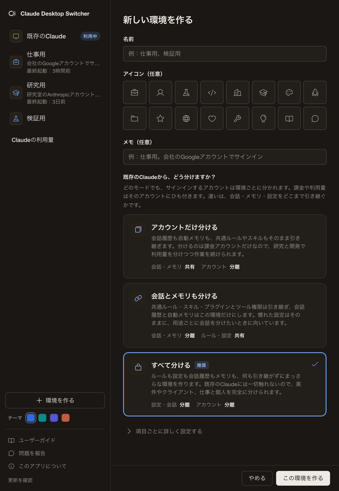
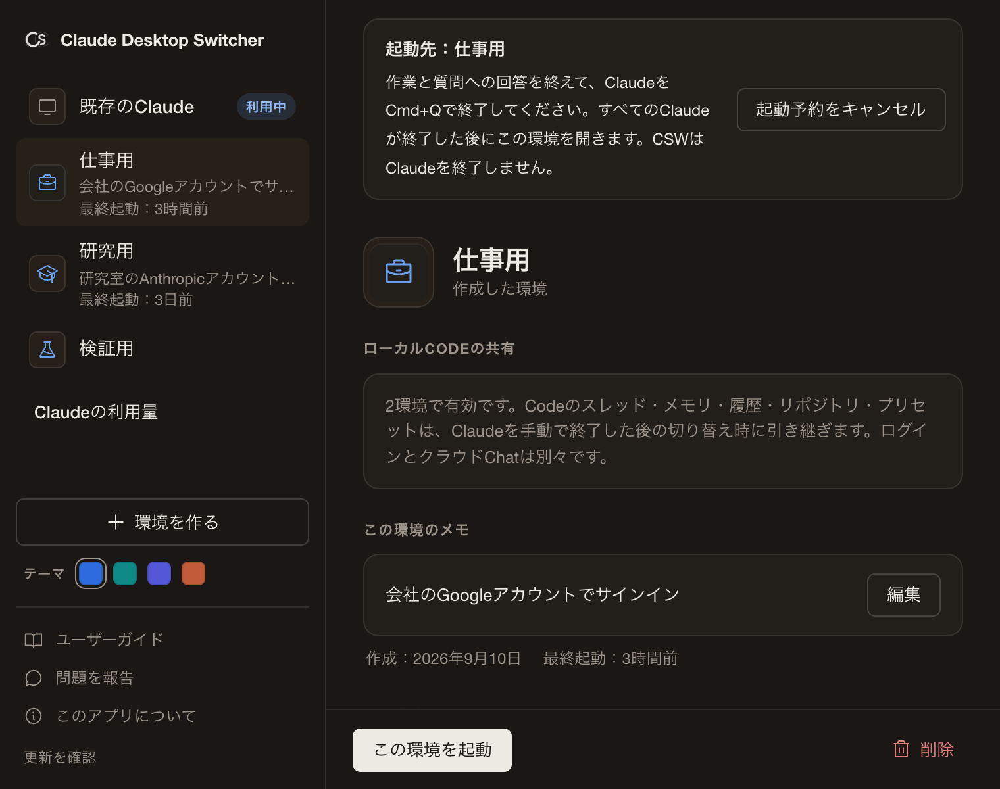
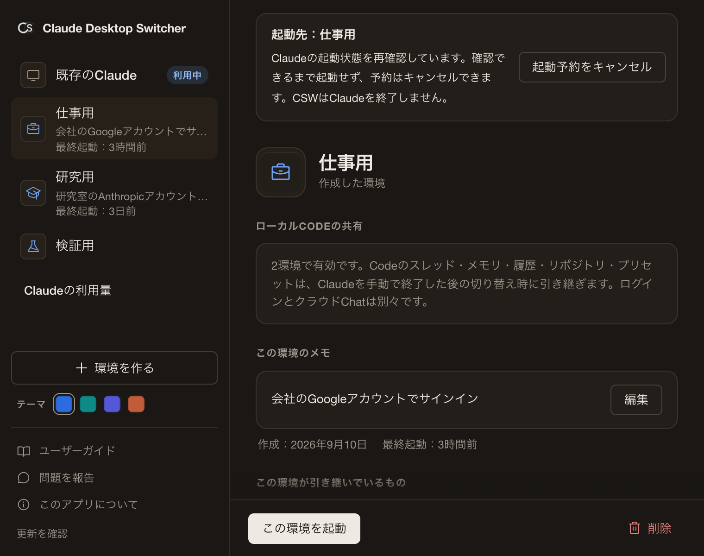
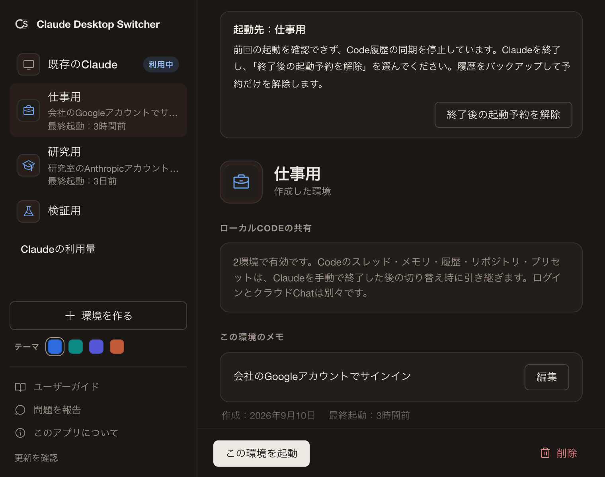

# Claude Desktop Switcher：ユーザーガイド

Claude Desktop Switcherは、ClaudeデスクトップアプリとClaude Code（CLI）の環境を、アカウント単位で安全に分離・管理するためのmacOSメニューバーユーティリティです。

### なぜこのツールが必要なのか、既存のワークアラウンドと何が違うのか
公式のClaudeデスクトップアプリには複数アカウントを切り替える機能がありません。これまでは、ターミナルから`--user-data-dir`を指定して別インスタンスを起動する方法や、`direnv`やエイリアスのようなCLI向けの切り替え手段が使われてきました。CLIのプロファイル切り替えは、こうしたCLI向けの手段がすでによく解決しています。
ただ、これらはそれぞれデスクトップとCLIの片方を受け持つ手段で、環境ごとの専用データディレクトリによるデスクトップアプリの分離と、CLI環境の連動を一度に行うものではありません。

本ツールを使うと、シェルスクリプトを書かずに、設定ウインドウから「**デスクトップアプリの分離**」をワンクリックで行えます。さらに、ターミナルからコマンドを実行すると、「**デスクトップアプリと連動したCLI環境の起動**」も行えます。システムの環境変数を一切破壊しない「ゼロ・インパクト原則」に基づいて設計されています。

---

## 0. 考え方：「既存のClaude」を基準に分ける

CSWはこの一点だけ理解すれば迷いません。

- **「既存のClaude」= あなたが普段使っているClaudeデスクトップアプリとClaude Codeの環境**。これが基準点です。ローカルCode全体の共有を明示的に有効にした場合だけCodeストアを置き換え、サインイン情報は対象外にします。
- **新しい環境を作る = 「既存のClaude」から、何を引き継ぎ・何を分けるかを決めること。** 共有・分離・コピーの「相手」は常に「既存のClaude」です。
  - **共有**：既存のClaudeと同じ実体を使います。変更は両方に反映されます
  - **分離**：この環境専用の新しい実体を持ちます。独立していて、最初は空です
  - **コピー**：作成時に一度だけ写し、以後は独立します
- **同じアカウントを使い続けたいだけなら、新しい環境は不要です。** その場合は「既存のClaude」をそのまま使えばよく、CSWを起動する必要すらありません。CSWが活きるのは「**別アカウント／別案件の独立環境**」を作りたいときです。
- **どの環境もアカウントは分かれます。** 各環境はそれぞれのアカウントでサインインし、課金と利用量はそのアカウントにひも付きます。サインイン情報やデバイスの識別子、コネクタを含むデスクトップアプリの設定は、どのモードでも環境ごとに分かれます。環境ごとに変わるのは「会話履歴と自動メモリを引き継ぐか」「共通ルールやスキルなどの設定を引き継ぐか」です。

---

## 1. インストールと初期セットアップ

通常の設定では既存のClaudeを維持します。後述するローカルCode全体の共有を明示的に有効にした場合は、ログインを分離したままCodeストアも同期します。

### ステップ1：アプリケーションのインストール
1. このフォークの共有機能を使う場合は、[このリポジトリのアプリとCLIをビルド](LOCAL_BUILD.md#build-and-use)してください。上流の配布版には含まれません。
2. ビルドした`target/release/bundle/macos/Claude-Desktop-Switcher.app`を開くか、「アプリケーション」フォルダへコピーします。CLIは`target/release/csw`です。
3. アプリを起動すると設定ウインドウが開きます。あわせて画面右上のメニューバーにアイコンが表示されます。メニューバーが混み合っているとアイコンは隠れることがありますが、Dockアイコンからいつでも設定ウインドウを開けます。インストールに使ったディスクイメージがマウントされたままの場合は、設定ウインドウの上部に案内が表示されるので、「取り出す」を押すとそのまま取り出せます。
4. 初回起動時のみ、ようこそ画面の下に補足カードが表示されます。内容は、既存のClaudeが保護されること、環境を切り替えて使えること、ターミナルのClaude Codeも同じ環境で使えること、の3点です。一度表示すれば以後は出ません。

### ステップ2：新しい環境の作成とカスタマイズ
仕事用や研究用の新しい独立環境を作成します。

**このフォークでは、新しい環境は「ローカルCodeを共有」が既定です。既存の環境の設定は変更しません。**

一方で、「個人で育てた共通ルールやスキル・プラグインをそのまま使い回しつつ、利用量だけは仕事用アカウントに計上したい」といった高度なユースケース向けに、柔軟なカスタマイズ機能を提供しています。

1. 起動時に自動で開く設定ウインドウを使います。閉じているときは、Dockアイコンか、メニューバーのアイコンの「**設定...**」から再表示できます。
2. 「**環境を作る**」ボタンをクリックします。
3. 環境の情報を入力します。
   * **名前**：`Work`や`Research`など
   * **アイコン（任意）**：用意したアイコンから選びます
   * **メモ（任意）**：用途や、サインインに使うアカウントを書いておけます。メモは環境の一覧に表示され、あとから詳細画面で編集できます。
4. **どう分けますか？4つのモードから選びます**
   初見でも迷わないよう、基本は次の4択です。どのモードでもアカウントは分かれ、変わるのは「何を引き継ぐか」です。引き継ぐものが多い順に並んでいます。細かく変えたい場合だけ「**項目ごとに詳しく設定する**」を開きます。

   * **ローカルCodeを共有（既定）**：Codeのスレッド・メモリ・入力履歴を共有します。初回サインイン後、詳細画面でバックアップしてサイドバー・リポジトリ・プリセットの共有を有効にします。クラウドChat・ログイン・ルール・権限・スキル・プラグインは分離します。
   * **アカウントだけ分ける**：会話履歴も自動メモリも引き継ぎ、分離するのはアカウントだけです。研究と開発で決済を分けつつ、ひとつながりの作業を続けたいときに選びます。
   * **会話とメモリも分ける**：共通ルール・スキル・プラグインとツール権限は引き継ぎ、会話履歴と自動メモリはこの環境だけにします。用途で分けつつ、慣れた設定を使い回したいときに選びます。
   * **すべて分ける**：分離したい場合の選択です。何も引き継がず完全に独立します。既存のClaudeには一切触れません。案件やクライアントごと、仕事用と個人用など、混ざってはいけないときに選びます。

   「会話とメモリも分ける」と「アカウントだけ分ける」の違いは、会話履歴と自動メモリ（projects/）と入力履歴（history.jsonl）を引き継ぐかどうかです。

   > Claude Codeの設定を`CLAUDE_CONFIG_DIR`で別の場所へ移しているときなど、既存のClaudeが標準の場所に見つからない場合、引き継ぐモードでも見つからない側の設定は引き継がれません。デスクトップ・CLIの両方とも見つからないときも、「ローカルCodeを共有」では空の会話・メモリ・入力履歴の保存先を作れます。サイドバーの共有は両方の環境でCodeを開いた後に有効にします。いずれの場合も作成画面に説明が表示されます。

   **＜ユースケースに合わせた選び方＞**
   * **ケースA：完全に別のプロジェクトとして作業する場合**
     「**すべて分ける**」を選びます。個人用とは切り離された、まっさらな環境が構築されます。
   * **ケースB：慣れた共通ルールやスキルを持ち込みつつ、会話とメモリは新しく始める場合**
     「**会話とメモリも分ける**」を選ぶと、共通ルール（CLAUDE.md）・ルールファイル（rules/）・スキル・プラグイン・ツール権限をそのまま引き継ぎつつ、会話履歴と自動メモリはこの環境だけになります。
   * **ケースC：研究と開発で決済を分けつつ、作業はそのまま続けたい場合**
     「**アカウントだけ分ける**」を選ぶと、会話履歴も自動メモリも引き継ぎ、分離するのはアカウントだけです。

5. 「**この環境を作る**」を押して保存します。

> **既存の環境の複製**
> 設定ウインドウで環境を選び「**複製**」ボタンを押すと、その環境の設定とデータをそのまま写した新しい環境を作成できます。似た構成をゼロから作り直す手間を省けます。会話履歴と自動メモリ、共通ルール、ルールファイル、スキル、ツール権限、入力履歴、ワークツリー一覧のうち「分離」と「コピー」の項目は複製先に写し、「共有」の項目は既存のClaudeへの共有のまま引き継ぎます。プラグインは、導入の記録が元の環境の場所を指しているため元の環境からは写さず、共有モードどおりに既存のClaudeから用意し直します。分離のときは空で始まるので、複製先で入れ直してください。アカウントのサインイン情報（config.json）、コネクタとアプリ設定、端末ID、セッションの実行状態は常に環境ごとに分かれるため写しません。ただし、Claudeデスクトップアプリは、サインインの状態を環境のフォルダのCookieにも保存しています。複製ではこのCookieをそのまま写します。そのため、複製先のClaudeデスクトップアプリは、複製元と同じアカウントでサインインした状態で開きます。複製元と複製先は同じサインインの状態を持つので、どちらかでログアウトすると、もう一方もログアウトされます。別のアカウントで使う環境は、複製ではなく「環境を作る」から作ってください。一方、ターミナルで使うClaude Codeは、サインイン情報をmacOSのキーチェーンに環境ごとに保存します。キーチェーンは環境のフォルダの外にあるので、この情報は複製先に写りません。複製先のターミナルでClaude Codeを初めて使うときは、ログインし直してください。Claude Codeがキーチェーンへ書けずに環境のフォルダに`.credentials.json`を置いていた場合は、このファイルも写るので、複製先も同じサインインの状態を持ちます。

---

## 2. 日々の使い方

セットアップ完了後の、日常的な利用手順です。手作業での難しい設定などは一切不要です。

### シナリオA：仕事用アカウント「Work」で作業を始める
1. 設定ウインドウで、作成した「Work」環境を選びます。設定ウインドウは、メニューバーのアイコンやDockアイコンからも開けます。一覧には各環境のメモと最終起動の時期が表示されるので、環境が増えても目的のものをすぐ見つけられます。
2. 「**この環境を起動**」を押します。別のClaudeが起動中なら、このフォークのローカル版は起動を予約し、対象の環境と終了待ちの案内を表示します。上流の配布版では、ボタンを押す前にClaudeを終了してください。詳しくは次の「Claudeを終了してから予約した環境を開く」を参照してください。
3. 作業と質問への回答を終え、Claudeメニューの「Claudeを終了」か「**Cmd+Q**」で通常どおり終了します。ウィンドウを閉じただけでは、アプリが動き続ける場合があります。ローカル版では、すべてのClaude Desktopが終了すると、CSWが予約した環境を開きます。

開いたウインドウは、その環境専用のデータ領域と保存済みのDesktopログインを使います。初回のみ、仕事用のアカウントでサインインしてください。初回の起動時には、CSWにも同じ案内のカードが表示されます。

> **メモ：環境の同時起動**
> 「会話とメモリも分ける」や「アカウントだけ分ける」で作った、設定を共有する環境は、設定の衝突を防ぐため一度に1つずつ開きます。個人用に戻すときは、サイドバーの「既存のClaude」を選んで「既存のClaudeを起動」を押してください。このフォークのローカル版では、作業を終えてClaudeを終了すると、CSWが予約した環境を開きます。上流の配布版では、ボタンを押す前にClaudeを終了してください。一方、「すべて分ける」で作った環境は何も共有しないため、起動中のClaudeを終了せずに、詳細画面の「重複して起動」で同時に開けます。

### Claudeを終了してから予約した環境を開く

この機能には、このフォークのローカルアプリ`0.24.6-local.6`以降が必要です。上流の配布版には含まれません。ビルドと導入の範囲は[ローカル版の説明](LOCAL_BUILD.md)を参照してください。

次の環境を選んで起動ボタンを押すか、メニューバーから選びます。別のClaude Desktopが起動中なら、設定ウインドウに予約先と「キャンセル」を表示します。CSWを起動したまま、Claudeの作業を終えてください。すべてのClaude Desktopを自分で終了すると、CSWが通常の停止状態での同期と起動を行います。ローカルCode全体の共有を有効にしている場合も、同期前にストアを検証してバックアップします。

- CSWは作業の完了を判定せず、質問に回答せず、終了要求やボタン操作、強制終了を行いません。終了するタイミングは自分で決めます。Accessibilityの許可、フック、追加のCLIログイン、ネットワーク接続は不要です。
- 終了待ちの間は、キャンセルすると起動を取り消せます。別の環境を予約するときは、現在の予約を先にキャンセルしてください。同じ環境を再び選んでも、予約は1つのままです。同期と起動が始まったあとはキャンセルできません。
- 予約はCSWのメモリだけに保持します。CSWを終了または再起動すると消え、古い予約を起動時に復元しません。
- 終了待ちの間にプロセスを検査できない場合は、キャンセル可能な予約を保持し、再確認中の案内を表示します。起動せずに1秒ごとに検査し、正常に確認できると自動で先へ進みます。この復帰にはローカル版`0.24.6-local.7`以降が必要です。対象の環境の変更・削除や、同期と起動の処理中の失敗は、自動で再実行せず起動を止めます。その場合は案内を確認してから予約し直してください。起動要求を送信したあとは、対象の実行を観測するまで予約を保持します。起動を確認できない場合は、エラーを表示しても予約を残し、二重起動を防ぐためキャンセル、置き換え、追加の起動を拒否します。観測は続けるため、遅れて起動が確認できれば予約は完了します。CSWを再起動する前に、Claudeの状態を確認してください。再起動でメモリ内の予約は消えますが、送信済みの起動や既存のCode共有の保護は取り消しません。
- 他の起動予約がない場合、利用中の環境を選ぶと、そのClaudeを前面に表示します。完全分離環境の「重複して起動」も同じキューを使いますが、他のClaudeの終了は待ちません。保留中の予約を飛び越えて起動することはできません。

「開き直す」は、起動の予約が保留中なら拒否し、他の起動と直列に実行します。`csw switch`コマンドに予約機能はありません。Claude Desktopが起動中の切り替えは、従来どおり拒否します。

### シナリオB：ターミナルでClaude Codeを使う
ターミナルには2種類あり、必要な操作が違います。いずれの場合も、その環境で初めてClaude Codeを使うときは、一度だけCLIのサインインが必要です。手順は後述の「初回だけ：Claude Codeのサインイン」にあります。

**1. CSWから開いたClaudeデスクトップアプリの内蔵ターミナル**
このアプリから環境を起動した場合、その中で開くターミナルは最初からその環境になっています。環境変数を切り替える追加のコマンドは不要で、そのまま`claude`と入力して作業を始められます。

**2. iTerm2や標準のTerminalなど、自分で別に開く外部ターミナル**
ご自身で新しく開いたターミナルは、普段の環境のままです。対象の環境を使うときは、連携コマンドを実行します。

このコマンドにはCLIツール`csw`が必要です。署名・公証済みの`csw`を[最新リリース](https://github.com/matsumotory/claude-desktop-switcher/releases/latest)からダウンロードし、実行権を付けて`PATH`の通った場所に置いてください。例：`chmod +x csw && mv csw /usr/local/bin/`。Rustの開発環境があれば、このリポジトリをcloneして、その中で`cargo install --path crates/cli`を実行しても導入できます。`csw`は`.dmg`には含まれていないため、アプリを更新しても`csw`は更新されません。入れている版は`csw --version`で確かめられます。デスクトップアプリだけで使う場合は、分離の検査が案内するリンクの修復を除いて不要です。

1. iTerm2や標準のTerminalなどのターミナルを開きます。
2. `eval $(csw env Work)`を実行します。`Work`の部分は対象の環境名に置き換えます。
3. そのタブの環境変数が対象の環境に切り替わります。この指定はそのタブだけに効き、普段の環境には影響しません。そのまま`claude`で作業を始めてください。

**初回だけ：Claude Codeのサインイン**
Claude Codeのサインインは、デスクトップアプリのサインインとは別に管理され、環境ごとに一度だけ必要です。上のどちらのターミナルでも、その環境でまだサインインしていない状態で`claude`を実行すると、自動でサインインを促されます。画面の案内に従い、サインイン方法の選択肢からサブスクリプションのClaudeアカウントを選んでください。API課金のアカウントとは別です。一度サインインすればその環境に保持されるため、次回以降や環境を切り替えたときに再サインインする必要はありません。内蔵ターミナルと、同じ環境に切り替えた外部ターミナルは、同じサインインを共有します。

### シナリオC：いつも通りの個人用の環境に戻る
* **デスクトップ**：設定ウインドウで「既存のClaude」を選んで「既存のClaudeを起動」を押すか、メニューバーから選びます。終了待ちになった場合は、作業を終えてすべてのClaude Desktopを通常どおり終了してください。Spotlightなどから`Claude.app`を直接開くと既存のClaudeを使い、CSWの同期は行いません。
* **CLI**：iTerm2など、ご自身で普通に開いたターミナルで`claude`と打てば、常に個人用の環境である既存のClaudeとして動作します。

### 保存済みのClaudeの利用量を確認する

この機能は、このフォークのローカルビルドに追加したものです。上のインストール手順で案内している上流の配布版には含まれません。

Claudeの利用量の画面には、既存のClaudeとCSWが見つけた環境を表示します。固定のアカウント一覧は持たず、保存済みの5時間・週間の使用率、記録にあるリセット時刻、最終確認時刻を示します。保存された応答に対応済みの追加の利用枠があれば、それも表示します。

読むのは、Claude Desktop Appがすでに保存した利用量の履歴と、対応する利用量の応答のキャッシュだけです。追加のサインインやClaude Codeへのサインインは不要で、パスワード・トークン・Cookie・キーチェーンは読みません。ローカル記録を再確認しても、記録を読み直すだけで、サーバーへの問い合わせやClaudeの起動は行いません。

- 記録から30分を超えると、古い記録として表示します。表示中のリセット時刻を過ぎた場合も同じです。保存済みの使用率はそのまま残し、0%に戻ったとは推測しません。
- 使用率やリセット時刻が欠けている場合は未取得と表示し、0に置き換えません。履歴だけを読めた場合は、使用率が表示されてもリセット時刻がないことがあります。
- 最終確認時刻は、保存された観測の時刻です。CSWを開いた時刻や読み直した時刻ではなく、古い記録を読み直しても新しい記録にはなりません。

この表示は環境に残った記録であり、いまサインインしているアカウントの確認結果ではありません。同じ環境でアカウントを変えたあと、以前の記録が残ることもあります。現在の値やアカウントを確かめる場合は、対象の環境で公式Claudeの利用量画面を確認してください。ローカル記録をいつ更新・削除するかはClaudeが決めるため、使っていない環境の値は古いままになったり、表示できなくなったりします。

---

## 3. 知っておくべき安心・安全の仕様

* **アプリを起動し忘れても安全です**
  Claude Desktop Switcherは、システムの環境変数を書き換えません。通常の起動では既存のClaudeを使います。ローカルCode全体の共有を有効にしている場合、その環境には前回同期したCodeストアが残ります。CSWを使わない起動では、新たな同期は行いません。
* **間違ったアカウントでの利用を防ぐ見分け方**
  ターミナルでどの環境を使っているか迷ったら、そのタブで`echo $CLAUDE_CONFIG_DIR`を実行します。表示されたパスが`.context-switcher-claude/profiles/<環境名>/cli-data`で終わればその環境です。何も表示されないか、`.claude`で終わるパスなら既存のClaudeです。`csw status`が表示するのは、設定ウインドウかメニューバーのアイコンから最後に起動した環境、または`csw switch`で最後に選んだ環境です。「重複して起動」で開いた環境では変わりません。そのタブの環境とは限りません。デスクトップアプリで複数の環境を並べて開いていて、どのウィンドウがどの環境か分からなくなったときは、CSWの一覧でその環境を選び「前面に表示」を押してください。その環境のClaudeが前面に出ます。macOSは同じアプリの複数ウィンドウをDockで1つのアイコンにまとめるため、Dockのアイコンでは見分けられません。CSWから名指しで前に出す形にしています。
* **アクセントカラーを選べます**
  サイドバー下部のスウォッチで、アクセントカラーをブルー・ティール・インディゴ・テラコッタの4色から選べます。既定はブルーです。選んだ色は保存され、次回も同じ配色で開きます。共有・分離・削除などの意味色は変わりません。
* **ヘルプとバージョン**
  サイドバー最下部から、「ユーザーガイド」「問題を報告」「このアプリについて」を開けます。問題の報告はGitHubのIssuesに届き、免責の内容は「このアプリについて」の画面にあります。現在のバージョンと、最新リリースを確かめる「更新を確認」も同じ場所にあります。外部リンクは既定のブラウザで開き、アプリ自体はインターネット通信を行いません。
* **何を読み書きするかを文書ですべて公開しています**
  このアプリが読む場所・書く場所・決して触れないものの一覧と、通信していないことをご自身のMacで確かめる手順を、[プライバシーと透明性](PRIVACY.md)にまとめています。宣言だけでなく、確かめ方まで含めて公開しています。
* **間違えて環境を消しても戻せます**
  ローカルCode全体の共有に参加している環境は、先に`csw unshare-code`で同期を無効にしてください。環境の削除は、フォルダごとmacOSのゴミ箱へ移動します。ゴミ箱を空にするまでは、サインイン状態や共有リンクも含めて何も失われていません。戻したいときは、ゴミ箱の中のフォルダを`~/.context-switcher-claude/profiles/`へ移動してください。CSWのウィンドウに戻ると、一覧にそのまま再表示されます。すぐに消したいときは、削除の確認で「完全に削除」を選びます。これはゴミ箱を経由せず、戻せません。
* **この環境のデータはどこに何があるかを見通せます**
  環境の詳細画面の「この環境のデータの場所」を開くと、データフォルダのパスに加えて、この環境が専有している容量と、フォルダごとの概算サイズ、項目ごとの内訳が表示されます。共有している項目はリンク先を、それ以外は概算サイズと最終更新を示します。表示のために読むのはファイル名とサイズ・最終更新の日時だけで、中身は開きません。各フォルダは「Finderで表示」でそのまま開けるので、バックアップのときも迷いません。
* **分離が保たれているかをいつでも点検できます**
  環境の詳細画面の「分離の検査」で「検査する」を押すと、共有と分離が設定どおりかを項目ごとに確認できます。検査はファイルの中身を読まず、何も書き換えません。ターミナルでは`csw doctor`で同じ検査ができます。`csw doctor --fix`は、共有元があるのにリンク先が想定と異なってしまった共有リンクを張り直し、共有元があるのに欠けている共有リンクを作ります。v0.24.2以降の`csw`は、共有元があり、共有リンクの位置に空のフォルダが残っているとき、そのフォルダも共有リンクに置き換えます。中身のあるフォルダとファイルには触れません。名前の似たClaude Code本体の`claude doctor`はインストールを診断する別のコマンドで、この検査とは関係ありません。

---

### このフォークでローカルCode全体を共有する

このフォークで新しい環境を作るときは「ローカルCodeを共有」が既定です。既存の環境の設定は変更しません。Codeの会話・メモリ・入力履歴を共有し、ルール・権限・スキル・プラグイン・ログインは分離します。

各環境で通常どおりサインインし、既存のClaudeと新しい環境の両方でCodeを一度開きます。作業と入力待ちが終わってからすべてのClaudeを手動で終了し、新しい環境の詳細画面で「Codeの共有を設定」→「バックアップして共有を有効にする」を選びます。共有元と置き換える環境名を確認してください。元データをバックアップしてから共有を開始します。CLIへのサインインは不要です。

次の環境を追加するときは既存の参加環境を維持し、共有グループの最新の変更を引き継ぎます。独立した変更が複数あれば上書きを拒否します。クラウドChat・Projects・ログインは共有しません。以後はSwitcherから起動してください。

以下のCLIコマンドは共有元を明示する場合や復旧用です。アプリの設定操作と異なり、指定した参加環境の組で共有グループを置き換えます。

[このフォークのアプリとCLIをビルド](LOCAL_BUILD.md#build-and-use)して、両方のローカル成果物を導入してください。上流の配布版には、これらのコマンドはありません。このフォークの`csw`を導入すると、会話履歴・プロジェクトのメモリ・入力履歴をすでに共有している環境間で、DesktopのCodeストア全体も共有できます。全Claude Desktopを終了し、`csw share-code --source default --replace Research Development`を実行します。例の環境名は自分の環境名に置き換えます。各環境でCodeを一度開いてあり、アカウント・ワークスペースの組が1つだけあることが必要です。全元データをバックアップしたあと、指定した元環境のストア全体で共有先を置き換えます。保存済みのCodeのツール権限、コネクタの参照、スケジュールタスク、アーカイブ・削除の記録、ワークツリーの所有情報も対象です。

設定後は、従来どおりSwitcherから環境を起動します。既存のDesktopログインは分離し、Claude Code CLIへのサインインは追加しません。参加環境の起動前に、最後に起動を確認して永続化した環境の完全な最新Codeストアを引き継ぎます。選択だけでは元環境を変えず、再起動後も確認済みの記録を使います。ファイルの更新時刻やフォーカス時刻で元環境を選びません。フォーカスとworktreeのGC時刻だけの変更は既存レコードに合流し、削除したスレッドは復活させません。プリセット、リポジトリ、worktree、未知のフィールドと削除の記録も引き継ぎます。直近16種類の既知の完全ストアに一致する古い共有先は置き換えられます。ほかの環境の未知の内容変更は、Code履歴の競合として停止します。すべての作業と書き込みを終えてClaudeを終了し、`csw share-code`で元環境を明示して再設定してください。別の起動中ウィンドウへ注入せず、Claudeの通常の起動で反映します。参加環境は1つずつ使います。クラウドProjects、クラウドChatの会話、Web側のカスタムグループは対象外です。バックアップと保存先の一覧は`~/.context-switcher-claude/native-code-backups/`に残します。

以後の同期を止めるには、全Claude Desktopを終了して`csw unshare-code`を実行します。現在のローカルデータとログインは維持し、共有前のストアへは戻しません。別途共有している会話履歴・メモリ・入力履歴のリンクも変更しません。参加環境を削除するには、先にこの同期を無効にしてください。

Claudeの起動を確認できなかった場合や起動要求が失敗した場合は、保存された起動の予約により、以後の同期を止めます。対象のプロセスを確認して記録を保存するまで元環境を変えません。確認の保存直後に中断した場合は、対応する予約だけを清掃できます。未確認の起動は成功と推測せず、再試行しません。全Claude Desktopを終了し、失敗の案内で「終了後の起動予約を解除」を選ぶか、`csw recover-code-launch --abandon`を実行してください。全参加環境のCodeストア、共有設定、保存された予約をバックアップしてから、予約だけを解除します。共有、現在のデータ、最後に確認した起動の記録は維持します。Switcherを開いている場合は、アプリの回復ボタンを使ってください。CLIで回復した場合は、次の起動予約の前にSwitcherを再起動し、失敗した予約の表示も解除してください。回復操作ではClaudeは起動しないので、使いたい環境を改めて選んで起動してください。コピーが中断中、環境の保存先が変更済み、予約が未対応の形式、内容が競合している場合は回復を拒否します。コピーが中断している場合は、記録とバックアップを確認し、先に中断した処理を解決してください。未知の更新は手動での解決が必要です。未確認の予約が残っている場合は、全書き込み元を終了して`csw unshare-code`で予約を解除し、共有を無効にしてから、`csw share-code --source <元環境名> --replace <ほかの環境名>`で使いたいデータを選び直してください。山括弧の部分は自分の環境名に置き換えます。再設定でも上書き前に全ストアをバックアップします。`share-code`だけでは未確認の予約を回避できません。コピーが中断していた場合は、各ストアの構成要素が元データか予定のコピーに一致するときだけ復元します。中断後の未知の更新があれば、記録とバックアップを残して復元を止め、明示的な解決を待ちます。

既存の共有設定は、次にClaudeを終了した状態で引き継ぐ際に移行します。完全なストアの生データの指紋が変わった環境が1つ以下なら、そのストアを直接引き継げます。複数の指紋が変わった場合は前回のバックアップで基準を検証し、内容が変わった環境が1つ以下の場合だけ進めます。過去の選択や時刻から起動元を推測しません。必要なバックアップから基準を検証できない場合や複数環境の内容が変わった場合は、元環境を明示して再設定してください。Switcher以外での起動には永続化した確認記録がないため、別の環境の内容変更は元環境の明示が必要になる場合があります。

## 4. よくある質問

**Q. 「共有」「分離」は、何に対しての共有・分離ですか？**
常に、あなたが普段使っている既存のClaudeに対してです。既存のClaudeと同じものを使うことを共有、この環境専用に新しく持つことを分離と呼び、新しい環境の項目ごとにどちらかを選びます。

**Q. 「既存のClaude」とは何ですか？**
あなたが普段使っている既存のClaudeデスクトップアプリとClaude Codeの環境そのものです。CSWはこれを基準にします。ローカルCode全体の共有を明示的に有効にした場合は、参加環境とCodeストアを同期します。サインイン情報は対象外です。アプリ内では環境一覧の先頭に「既存のClaude」として並びます。

**Q. 同じアカウントを使うだけでも、新しい環境を作る必要がありますか？**
いいえ。同じアカウント・同じ環境を使い続けたいだけなら、新しい環境は不要です。いつもどおりClaudeを起動すれば「既存のClaude」がそのまま使われます。CSWが役立つのは、別アカウントや別案件のために独立した環境を増やしたいときです。

**Q. 新しい環境を作ると、既存のClaudeは壊れませんか？**
壊れません。新しい環境は専用ディレクトリに作られ、既存のClaudeとは物理的に分かれています。環境を削除しても、既存のClaudeには影響しません。

**Q. 切り替えるたびに再サインインが必要ですか？**
いいえ。Claudeデスクトップアプリのサインインは、その環境のフォルダの中に保持されます。Claude Codeのサインインは、macOSのキーチェーンに環境ごとに分けて保存されます。どちらも初回だけサインインすれば、以後は切り替えてもサインインは保たれます。「環境を作る」で作った環境では、作った直後にその環境で一度サインインします。複製で作った環境のClaudeデスクトップアプリは、複製元と同じアカウントでサインインした状態で開きます。

**Q. デスクトップアプリを切り替えると、ターミナルのClaude Codeも自動で揃いますか？**
CSWから開いたアプリの中のターミナルは、最初からそのアプリと同じ環境なので、コマンドは要りません。ご自身で別に開いたターミナルは普段の環境のままなので、対象の環境名を渡して`eval $(csw env Work)`を実行して明示的に揃えてください。この指定はそのタブだけに効き、普段の環境には影響しません。環境の設定ディレクトリは自動で揃いますが、その環境で初めてClaude Codeを使うときは、CLIのサインインが別途一度だけ必要です。詳しくは次のQを参照してください。

**Q. デスクトップアプリにサインインしていれば、ターミナルのClaude Codeもサインイン済みですか？**
いいえ。デスクトップアプリのサインインとClaude Codeのサインインは、別々に管理されます。各環境でターミナルから初めて`claude`を使うときに、その環境で一度だけCLIのサインインが必要です。サインイン方法は、サブスクリプションのアカウントを選びます。一度サインインすればその環境に保持され、以後は環境を切り替えても再サインインは不要です。内蔵ターミナルと、同じ環境に切り替えた外部ターミナルは、同じサインインを共有します。詳しくは「2. 日々の使い方」のシナリオBを参照してください。

**Q. 各環境でのClaudeの利用量をCSWで一覧できますか？**
このフォークのローカルビルドで対応しています。Claude Desktop Appがすでに保存した記録から、見つかったすべての環境の使用率、記録にあるリセット時刻、最終確認時刻を表示します。30分を超えた記録やリセット時刻を過ぎた記録は古い記録として、欠けた値は未取得として示します。CSWは通信もサインイン情報の読み取りも行いません。現在の値やサインイン中のアカウントを保証するものではありません。上の「保存済みのClaudeの利用量を確認する」を参照してください。

**Q. 「会話とメモリも分ける」を選ぶと、具体的に何を引き継ぎますか？**
共通ルール（CLAUDE.md）・ルールファイル（rules/）・スキル（skills/）・プラグイン（plugins/）・ツール権限とフック（settings.json）・ワークツリー一覧（git-worktrees.json）を、既存のClaudeから引き継ぎます。一方で、プロジェクトの会話・メモリ（projects/）と入力履歴（history.jsonl）は、この環境だけにします。アカウントのサインイン情報（config.json）・コネクタとアプリ設定（claude_desktop_config.json）・端末ID（ant-did）・セッションの実行状態（sessions/）は、常に環境ごとに分かれます。細かく変えたい場合は作成画面の「項目ごとに詳しく設定する」で個別に調整できます。

**Q. 「アカウントだけ分ける」を選ぶと、何が変わりますか？**
共通ルール・スキル・プラグイン・ツール権限に加えて、プロジェクトの会話・メモリ（projects/）と入力履歴（history.jsonl）も引き継ぎます。分離するのはアカウントだけです。課金とClaudeの利用量は、その環境でサインインしたアカウントにひも付きます。研究と開発で決済を分けつつ、ひとつながりの作業を続けたいときに向きます。なお、コネクタとアプリ設定・セッションの実行状態は、このモードでも環境ごとに分かれます。

**Q. `~/.claude/rules/`に分けて置いたルールファイルも引き継がれますか？**
はい。Claude Codeは`~/.claude/rules/`のルールファイルを、`~/.claude/CLAUDE.md`と同じくすべてのプロジェクトで読み込みます。CSWでは「ルールファイル」という項目として共通ルール（CLAUDE.md）と同じように扱い、「アカウントだけ分ける」と「会話とメモリも分ける」では`rules/`も共有します。作成画面の「項目ごとに詳しく設定する」にある「ルールファイル」の行で、個別に変えることもできます。

v0.24.0以前のCSWで作った環境には`rules/`の共有リンクがまだありません。環境の詳細画面の「分離の検査」で「共有のリンクがありません」と表示されたら、ターミナルで`csw doctor --fix`を実行するとリンクを作れます。`rules/`の共有リンクを作れるのはv0.24.1以降の`csw`です。`csw`はアプリとは別に配布しているので、アプリを更新しても`csw`は更新されません。v0.24.2より前の`csw`は、どれも`csw --version`で`csw 0.1.0`と表示し、版を見分けられません。そう表示されたら、最新リリースから`csw`を入れ直してから`csw doctor --fix`を実行してください。

環境を作ったときに`~/.claude/rules/`がまだ無かった場合は、環境フォルダに空の`cli-data/rules`フォルダが作られます。`~/.claude/rules/`が無いあいだ、検査はこの項目を「共有元がまだありません」と表示し、問題として扱いません。あとから`~/.claude/rules/`を作ると、検査は「共有のリンクの位置に実体のフォルダがあります」と表示します。v0.24.2より前のアプリでは、この表示は「共有のリンクが実体のファイルに置き換わっています」です。この状態でv0.24.2以降の`csw`から`csw doctor --fix`を実行すると、空のフォルダが共有リンクに置き換わります。v0.24.2より前の`csw`はこのフォルダを置き換えないので、最新リリースから`csw`を入れ直してから実行してください。

なお、デスクトップのCoworkセッションでは、Claude Codeはリンクになっている`~/.claude/CLAUDE.md`と`~/.claude/rules/`を読み込みません。これは共有モード全体に共通するClaude Code側の仕様です。

**Q. メモリと会話履歴は何が違いますか？**
メモリは、過去から要約・抽出された洞察で、人が書く共通ルール（CLAUDE.md）とルールファイル（rules/）、Claudeが書く自動メモリ（projects/<プロジェクト>/memory/）の2つがあります。会話履歴は生のやり取りの記録で、実体はprojects/<プロジェクト>/の.jsonlです。「アカウントだけ分ける」は会話履歴と自動メモリの両方を引き継ぎ、「会話とメモリも分ける」は会話履歴と自動メモリをこの環境だけにします。人が書く共通ルール（CLAUDE.md）とルールファイル（rules/）は、どちらのモードでも既存のClaudeと共有します。

**Q. コネクタ（MCP）やアプリ設定は引き継がれますか？**
いいえ。コネクタとアプリ設定（claude_desktop_config.json）は、どのモードでも環境ごとに分かれます。デスクトップアプリはアカウント認証や起動時の書き換えのため安全に共有できず、設定を引き継ぐ中心はClaude Code側の共通ルール・スキル・プラグイン・ツール権限です。

**Q. いま前面にあるClaudeがどの環境か確かめられますか？**
はい。メニューバーのアイコンから「**いまの環境を確認**」を押すと、前面にあるClaudeがどの環境かを判定し、設定ウインドウでその環境を選択して答えます。完全分離環境を並べて開いていて、見た目の同じウィンドウを取り違えたくないときに使えます。前面のアプリを調べるのはこの操作のときだけです。

**Q. Claude Desktopの更新のあと、環境から外れてしまうことはありますか？**
はい、起きることがあります。更新後の自動再起動はCSWを経由しないため、開き直されたClaudeは既存のClaudeのデータで動きます。見た目は同じウィンドウなので気づきにくいですが、CSWでは「利用中」の表示が既存のClaudeに移り、CSWが起動していれば設定ウインドウに案内が表示されます。元の環境で続けるには、Claudeを終了してから「この環境を起動」を押してください。

**Q. 更新のたびに、開いていた環境を全部手で開き直すのが面倒です。**
更新を適用するには、開いているClaudeを全部終了する必要があります。Claude側の更新の仕組みが、アプリを差し替える前にすべての終了を待つためです。そこで、前回すべて閉じたときに同時に開いていた環境をCSWが覚えておき、設定ウインドウのバナーから「開き直す」を1回押すだけでまとめて開き直せます。いま動いている環境は自動で除きます。共有を含む環境が別のClaudeと同時に開けないときは、その環境だけ、先に動いているClaudeを終了するよう案内します。この「開き直す」の操作では、ボタンを押したときだけ起動します。別途予約した起動は、前述の手動終了を待つ手順で実行します。

